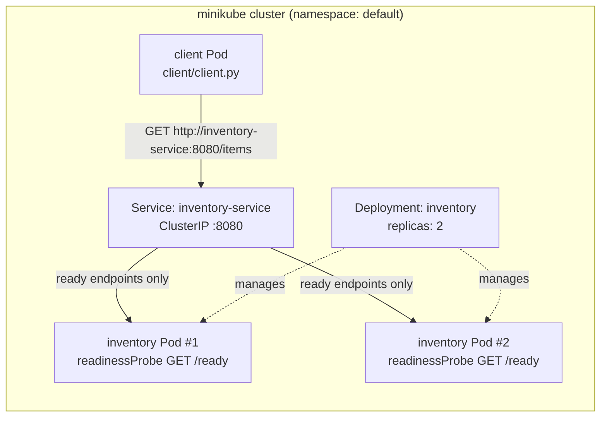

# Module 6 Lab: Service Discovery, Readiness, and Pod Replacement on Kubernetes

An **Inventory** service runs as a Deployment with 2 replicas behind a Kubernetes Service named `inventory-service`. A **client** Pod calls `http://inventory-service:8080/items` once per second and logs which Inventory Pod answered. The client only uses the Service name, never individual Pod IPs.

## Architecture



- `app/inventory.py`: Inventory HTTP service. `GET /items` returns the item list plus the name/IP of the Pod that served it. `GET /ready` returns `200`, or `503` if the file `/tmp/unready` exists.
- `client/client.py`: calls the Service by name every second and prints `served-by=<pod>`.
- `k8s/`: the Inventory Deployment (2 replicas + readiness probe), the `inventory-service` Service, and the client Deployment.
- `kustomization.yaml`: packages both scripts into ConfigMaps and applies all manifests. Both containers use the stock `python:3.12-alpine` image, so no image build is needed.

## Deploying

Prerequisites: [minikube](https://minikube.sigs.k8s.io/) and `kubectl`. Tested with minikube v1.39.0 (Kubernetes v1.37.0) on macOS.

```bash
minikube start                     # tested with: minikube start --driver=vfkit --memory=4096
kubectl apply -k .
kubectl rollout status deployment/inventory
kubectl get pods -o wide
kubectl logs -f deployment/client  # watch which replica serves each request
```

To see whether each Pod is a ready endpoint of the Service, run:

```bash
kubectl get endpointslice -l kubernetes.io/service-name=inventory-service \
  -o jsonpath='{range .items[*].endpoints[*]}{.targetRef.name}{"  "}{.addresses[0]}{"  ready="}{.conditions.ready}{"\n"}{end}'
```

## Results

Client log times are in UTC.

### 1. Deployment: both replicas running and receiving requests

```text
$ kubectl apply -k .
configmap/client-app created
configmap/inventory-app created
service/inventory-service created
deployment.apps/client created
deployment.apps/inventory created

$ kubectl get pods -o wide
NAME                         READY   STATUS    RESTARTS   AGE   IP           NODE       NOMINATED NODE   READINESS GATES
client-557cd5f75b-vmb5z      1/1     Running   0          6s    10.244.0.4   minikube   <none>           <none>
inventory-77c8784dfb-p78kr   1/1     Running   0          6s    10.244.0.3   minikube   <none>           <none>
inventory-77c8784dfb-qq2c6   1/1     Running   0          6s    10.244.0.5   minikube   <none>           <none>

$ kubectl get svc inventory-service
NAME                TYPE        CLUSTER-IP      EXTERNAL-IP   PORT(S)    AGE
inventory-service   ClusterIP   10.96.199.216   <none>        8080/TCP   6s

$ kubectl get endpointslice -l kubernetes.io/service-name=inventory-service
NAME                      ADDRESSTYPE   PORTS   ENDPOINTS               AGE
inventory-service-9z7bx   IPv4          8080    10.244.0.5,10.244.0.3   77s
```

The client resolves the Service name through cluster DNS:

```text
$ kubectl exec deploy/client -- nslookup inventory-service
Server:		10.96.0.10
Address:	10.96.0.10:53
Name:	inventory-service.default.svc.cluster.local
Address: 10.96.199.216
```

Requests to `inventory-service` reach **both** replicas:

```text
$ kubectl logs deploy/client --tail=15
06:06:29 OK  served-by=inventory-77c8784dfb-qq2c6 ip=10.244.0.5 items=3
06:06:30 OK  served-by=inventory-77c8784dfb-p78kr ip=10.244.0.3 items=3
06:06:31 OK  served-by=inventory-77c8784dfb-p78kr ip=10.244.0.3 items=3
06:06:32 OK  served-by=inventory-77c8784dfb-qq2c6 ip=10.244.0.5 items=3
06:06:33 OK  served-by=inventory-77c8784dfb-qq2c6 ip=10.244.0.5 items=3
06:06:34 OK  served-by=inventory-77c8784dfb-qq2c6 ip=10.244.0.5 items=3
06:06:35 OK  served-by=inventory-77c8784dfb-p78kr ip=10.244.0.3 items=3
06:06:36 OK  served-by=inventory-77c8784dfb-p78kr ip=10.244.0.3 items=3
06:06:37 OK  served-by=inventory-77c8784dfb-qq2c6 ip=10.244.0.5 items=3
06:06:38 OK  served-by=inventory-77c8784dfb-qq2c6 ip=10.244.0.5 items=3
06:06:39 OK  served-by=inventory-77c8784dfb-p78kr ip=10.244.0.3 items=3
06:06:40 OK  served-by=inventory-77c8784dfb-p78kr ip=10.244.0.3 items=3
06:06:41 OK  served-by=inventory-77c8784dfb-qq2c6 ip=10.244.0.5 items=3
06:06:42 OK  served-by=inventory-77c8784dfb-qq2c6 ip=10.244.0.5 items=3
06:06:43 OK  served-by=inventory-77c8784dfb-qq2c6 ip=10.244.0.5 items=3

$ kubectl logs deploy/client | grep -o "served-by=[^ ]*" | sort | uniq -c
  12 served-by=inventory-77c8784dfb-p78kr
  19 served-by=inventory-77c8784dfb-qq2c6
```

### 2. Readiness test: failure and recovery

The readiness probe (`GET /ready` every 2s, `failureThreshold: 1`) is defined in `k8s/inventory-deployment.yaml`. To make one Pod unready, I created `/tmp/unready` inside it so `/ready` returns `503`:

```text
$ kubectl exec inventory-77c8784dfb-p78kr -- touch /tmp/unready

$ kubectl get pods -l app=inventory
NAME                         READY   STATUS    RESTARTS   AGE
inventory-77c8784dfb-p78kr   0/1     Running   0          100s
inventory-77c8784dfb-qq2c6   1/1     Running   0          100s

$ kubectl describe pod inventory-77c8784dfb-p78kr | grep -A6 Conditions
Conditions:
  Type                        Status
  PodReadyToStartContainers   True
  Initialized                 True
  Ready                       False
  ContainersReady             False
  PodScheduled                True

$ kubectl get events --field-selector involvedObject.name=inventory-77c8784dfb-p78kr,reason=Unhealthy
LAST SEEN   TYPE      REASON      OBJECT                           MESSAGE
0s          Warning   Unhealthy   pod/inventory-77c8784dfb-p78kr   Readiness probe failed: HTTP probe failed with statuscode: 503

$ kubectl get endpointslice ... (ready state per Pod)
inventory-77c8784dfb-qq2c6  10.244.0.5  ready=true
inventory-77c8784dfb-p78kr  10.244.0.3  ready=false
```

The unready Pod is still `Running` with 0 restarts, but the Service stops sending it traffic. Every request goes to the ready Pod:

```text
$ kubectl logs deploy/client --since=15s
06:07:07 OK  served-by=inventory-77c8784dfb-qq2c6 ip=10.244.0.5 items=3
06:07:08 OK  served-by=inventory-77c8784dfb-qq2c6 ip=10.244.0.5 items=3
06:07:09 OK  served-by=inventory-77c8784dfb-qq2c6 ip=10.244.0.5 items=3
06:07:10 OK  served-by=inventory-77c8784dfb-qq2c6 ip=10.244.0.5 items=3
06:07:11 OK  served-by=inventory-77c8784dfb-qq2c6 ip=10.244.0.5 items=3
06:07:12 OK  served-by=inventory-77c8784dfb-qq2c6 ip=10.244.0.5 items=3
06:07:13 OK  served-by=inventory-77c8784dfb-qq2c6 ip=10.244.0.5 items=3
06:07:14 OK  served-by=inventory-77c8784dfb-qq2c6 ip=10.244.0.5 items=3
06:07:15 OK  served-by=inventory-77c8784dfb-qq2c6 ip=10.244.0.5 items=3
06:07:16 OK  served-by=inventory-77c8784dfb-qq2c6 ip=10.244.0.5 items=3
06:07:17 OK  served-by=inventory-77c8784dfb-qq2c6 ip=10.244.0.5 items=3
06:07:18 OK  served-by=inventory-77c8784dfb-qq2c6 ip=10.244.0.5 items=3
06:07:19 OK  served-by=inventory-77c8784dfb-qq2c6 ip=10.244.0.5 items=3
06:07:20 OK  served-by=inventory-77c8784dfb-qq2c6 ip=10.244.0.5 items=3
06:07:21 OK  served-by=inventory-77c8784dfb-qq2c6 ip=10.244.0.5 items=3

$ kubectl logs deploy/client --since=15s | grep -o "served-by=[^ ]*" | sort | uniq -c
  15 served-by=inventory-77c8784dfb-qq2c6
```

**Recovery:** after I removed the file, the Pod became ready again and started receiving traffic:

```text
$ kubectl exec inventory-77c8784dfb-p78kr -- rm /tmp/unready

$ kubectl get pods -l app=inventory
NAME                         READY   STATUS    RESTARTS   AGE
inventory-77c8784dfb-p78kr   1/1     Running   0          2m1s
inventory-77c8784dfb-qq2c6   1/1     Running   0          2m1s

$ kubectl get endpointslice ... (ready state per Pod)
inventory-77c8784dfb-qq2c6  10.244.0.5  ready=true
inventory-77c8784dfb-p78kr  10.244.0.3  ready=true

$ kubectl logs deploy/client --since=15s
06:07:28 OK  served-by=inventory-77c8784dfb-qq2c6 ip=10.244.0.5 items=3
06:07:29 OK  served-by=inventory-77c8784dfb-qq2c6 ip=10.244.0.5 items=3
06:07:30 OK  served-by=inventory-77c8784dfb-qq2c6 ip=10.244.0.5 items=3
06:07:31 OK  served-by=inventory-77c8784dfb-p78kr ip=10.244.0.3 items=3
06:07:32 OK  served-by=inventory-77c8784dfb-qq2c6 ip=10.244.0.5 items=3
06:07:33 OK  served-by=inventory-77c8784dfb-qq2c6 ip=10.244.0.5 items=3
06:07:34 OK  served-by=inventory-77c8784dfb-p78kr ip=10.244.0.3 items=3
06:07:35 OK  served-by=inventory-77c8784dfb-qq2c6 ip=10.244.0.5 items=3
06:07:36 OK  served-by=inventory-77c8784dfb-qq2c6 ip=10.244.0.5 items=3
06:07:37 OK  served-by=inventory-77c8784dfb-p78kr ip=10.244.0.3 items=3
06:07:38 OK  served-by=inventory-77c8784dfb-qq2c6 ip=10.244.0.5 items=3
06:07:39 OK  served-by=inventory-77c8784dfb-p78kr ip=10.244.0.3 items=3
06:07:40 OK  served-by=inventory-77c8784dfb-qq2c6 ip=10.244.0.5 items=3
06:07:41 OK  served-by=inventory-77c8784dfb-p78kr ip=10.244.0.3 items=3
06:07:42 OK  served-by=inventory-77c8784dfb-qq2c6 ip=10.244.0.5 items=3

$ kubectl logs deploy/client --since=15s | grep -o "served-by=[^ ]*" | sort | uniq -c
   5 served-by=inventory-77c8784dfb-p78kr
  10 served-by=inventory-77c8784dfb-qq2c6
```

### 3. Pod failure and recovery

**Before:**

```text
$ kubectl get pods -l app=inventory -o wide
NAME                         READY   STATUS    RESTARTS   AGE     IP           NODE       NOMINATED NODE   READINESS GATES
inventory-77c8784dfb-p78kr   1/1     Running   0          2m29s   10.244.0.3   minikube   <none>           <none>
inventory-77c8784dfb-qq2c6   1/1     Running   0          2m29s   10.244.0.5   minikube   <none>           <none>

$ kubectl get svc inventory-service
NAME                TYPE        CLUSTER-IP      EXTERNAL-IP   PORT(S)    AGE
inventory-service   ClusterIP   10.96.199.216   <none>        8080/TCP   2m29s
```

**Delete one Pod.** The Deployment's ReplicaSet immediately creates a replacement with a new name and IP:

```text
$ kubectl delete pod inventory-77c8784dfb-qq2c6
pod "inventory-77c8784dfb-qq2c6" deleted from default namespace

$ kubectl get pods -l app=inventory -o wide
NAME                         READY   STATUS        RESTARTS   AGE     IP           NODE       NOMINATED NODE   READINESS GATES
inventory-77c8784dfb-9cj8j   0/1     Running       0          3s      10.244.0.7   minikube   <none>           <none>
inventory-77c8784dfb-p78kr   1/1     Running       0          2m32s   10.244.0.3   minikube   <none>           <none>
inventory-77c8784dfb-qq2c6   1/1     Terminating   0          2m32s   10.244.0.5   minikube   <none>           <none>

$ kubectl get events --field-selector involvedObject.kind=ReplicaSet,reason=SuccessfulCreate
LAST SEEN   TYPE     REASON             OBJECT                            MESSAGE
2m48s       Normal   SuccessfulCreate   replicaset/inventory-77c8784dfb   Created pod: inventory-77c8784dfb-p78kr
2m48s       Normal   SuccessfulCreate   replicaset/inventory-77c8784dfb   Created pod: inventory-77c8784dfb-qq2c6
19s         Normal   SuccessfulCreate   replicaset/inventory-77c8784dfb   Created pod: inventory-77c8784dfb-9cj8j
```

**After:** the replacement Pod `inventory-77c8784dfb-9cj8j` (new name, new IP `10.244.0.7`) is ready. The Service still has the same name and ClusterIP (`10.96.199.216`), and its endpoints now point at the new Pod:

```text
$ kubectl get pods -o wide
NAME                         READY   STATUS    RESTARTS   AGE     IP           NODE       NOMINATED NODE   READINESS GATES
client-6ccd4d6d9f-7b5vs      1/1     Running   0          2m14s   10.244.0.6   minikube   <none>           <none>
inventory-77c8784dfb-9cj8j   1/1     Running   0          31s     10.244.0.7   minikube   <none>           <none>
inventory-77c8784dfb-p78kr   1/1     Running   0          3m      10.244.0.3   minikube   <none>           <none>

$ kubectl get svc inventory-service
NAME                TYPE        CLUSTER-IP      EXTERNAL-IP   PORT(S)    AGE
inventory-service   ClusterIP   10.96.199.216   <none>        8080/TCP   3m

$ kubectl get endpointslice ... (ready state per Pod)
inventory-77c8784dfb-p78kr  10.244.0.3  ready=true
inventory-77c8784dfb-9cj8j  10.244.0.7  ready=true
```

The client kept communicating through `inventory-service` the whole time. The Pod was deleted at 06:07:55, `qq2c6` served its last request at 06:07:54, `p78kr` handled traffic alone until the replacement was ready, and `9cj8j` began serving at 06:08:01. The client logged zero failed requests:

```text
$ kubectl logs deploy/client --since=25s
06:07:49 OK  served-by=inventory-77c8784dfb-qq2c6 ip=10.244.0.5 items=3
06:07:50 OK  served-by=inventory-77c8784dfb-qq2c6 ip=10.244.0.5 items=3
06:07:51 OK  served-by=inventory-77c8784dfb-p78kr ip=10.244.0.3 items=3
06:07:52 OK  served-by=inventory-77c8784dfb-qq2c6 ip=10.244.0.5 items=3
06:07:53 OK  served-by=inventory-77c8784dfb-qq2c6 ip=10.244.0.5 items=3
06:07:54 OK  served-by=inventory-77c8784dfb-qq2c6 ip=10.244.0.5 items=3
06:07:55 OK  served-by=inventory-77c8784dfb-p78kr ip=10.244.0.3 items=3
06:07:56 OK  served-by=inventory-77c8784dfb-p78kr ip=10.244.0.3 items=3
06:07:57 OK  served-by=inventory-77c8784dfb-p78kr ip=10.244.0.3 items=3
06:07:58 OK  served-by=inventory-77c8784dfb-p78kr ip=10.244.0.3 items=3
06:07:59 OK  served-by=inventory-77c8784dfb-p78kr ip=10.244.0.3 items=3
06:08:00 OK  served-by=inventory-77c8784dfb-p78kr ip=10.244.0.3 items=3
06:08:01 OK  served-by=inventory-77c8784dfb-9cj8j ip=10.244.0.7 items=3
06:08:02 OK  served-by=inventory-77c8784dfb-9cj8j ip=10.244.0.7 items=3
06:08:03 OK  served-by=inventory-77c8784dfb-9cj8j ip=10.244.0.7 items=3
06:08:04 OK  served-by=inventory-77c8784dfb-9cj8j ip=10.244.0.7 items=3
06:08:05 OK  served-by=inventory-77c8784dfb-p78kr ip=10.244.0.3 items=3
06:08:06 OK  served-by=inventory-77c8784dfb-9cj8j ip=10.244.0.7 items=3
06:08:07 OK  served-by=inventory-77c8784dfb-p78kr ip=10.244.0.3 items=3
06:08:08 OK  served-by=inventory-77c8784dfb-p78kr ip=10.244.0.3 items=3
06:08:09 OK  served-by=inventory-77c8784dfb-9cj8j ip=10.244.0.7 items=3
06:08:10 OK  served-by=inventory-77c8784dfb-p78kr ip=10.244.0.3 items=3
06:08:12 OK  served-by=inventory-77c8784dfb-9cj8j ip=10.244.0.7 items=3
06:08:13 OK  served-by=inventory-77c8784dfb-9cj8j ip=10.244.0.7 items=3
06:08:14 OK  served-by=inventory-77c8784dfb-9cj8j ip=10.244.0.7 items=3

$ kubectl logs deploy/client | grep -c ERR
0
```

## Reflection

Pods are disposable: when one fails, is deleted, or is rescheduled, Kubernetes replaces it with a new Pod that has a different name and IP address, as `qq2c6` was replaced by `9cj8j` in this lab. If the client depended on Pod addresses, it would break every time that happened. A stable Service name like `inventory-service` gives clients one fixed DNS name and ClusterIP, while Kubernetes keeps the list of backing Pods up to date behind it. Because that list includes only *ready* Pods, the Service also avoids sending traffic to Pods that are starting, shutting down, or failing readiness, as the readiness test showed. As a result, the client never had to change its configuration and saw zero failed requests through a readiness failure and a Pod deletion.
